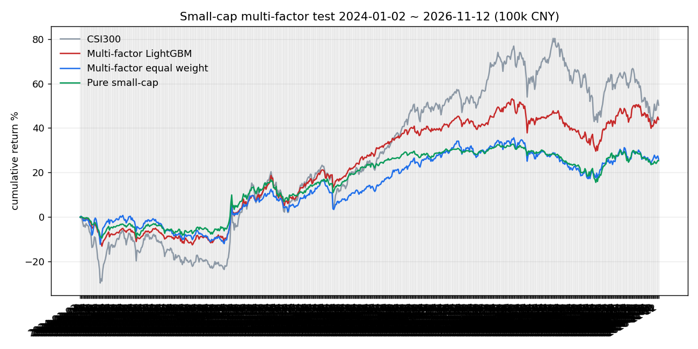
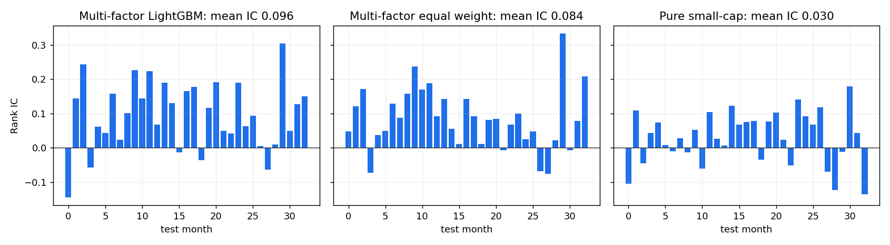

# 小市值多因子：全 A 股月度选股实验

> 2026-11-12。把「小市值 + 多因子」这条更接近传统量化的路线搬到 A 股全市场：14 个价量/估值/风险因子，行业中性化后做截面排序，季度调仓 50 只，和 Share v2 的五条深度模型在同一套账户规则下比较。

> 模拟盘，仅供策略研究，不构成投资建议。

## 0. 结论

2024-01-02 – 2026-11-12 的样本外回放给出一个很清楚的分离：**截面信号很强；把调仓频率和持仓规则调对后，小资金组合能吃到其中一部分，但吃不满。**

- 测试 Rank IC：多因子 LightGBM **0.0965**（ICIR 3.34，85% 月份为正）、等权 **0.0838**、纯小市值 **0.0299**；都高于 Share v2 深度模型的 0.043–0.060，但两者股票池/频率不同，不能直接比。
- **参数调优按验证集选择**：2022–2023 上扫描 12 组「持仓数 × 缓冲 × 调仓频率」，季度调仓 + 全量换成前 50 名最好（验证 +23.97%、Sharpe 0.91）；放到 2024–2026 复核，10 万账户 **+43.82%**（Sharpe 0.96、最大回撤 -15.4%），比原来的月度调仓 **+15.51%** 大幅改善；3 万从 +0.49% 提到 **+19.5%**。
- 同期全市场等权基准 **+50.25%**，小市值池等权自身约 **+55%**；季度调仓把差距从 -35 个百分点缩到约 -6 个百分点，但 10 万账户期末现金 7.1 万（约为净资产的 50%，相当于初始本金的 71%）（50 只 × 10 万 = 每只 2,000 元，很多小市值股票一手就超过这个目标）。
- LightGBM 超参扫描 5 组：验证 IC 0.1067–0.1094、测试 0.0965–0.0974，差异在种子噪声内，**保留原配置**；这一轮的主要收益来自组合执行参数，而不是模型参数。
- 结论：**多因子小市值在 A 股是有效的排序信号；季度调仓是当前数据上性价比最高的改动。** 下一步若继续提收益，优先试「20–30 只 + 更大本金/更低换手」，而不是继续加因子或加模型容量。

## 1. 为什么换思路

Share v2 已经把「60 日窗口 → 5 日截面排序」的深度模型做到测试 Rank IC 0.043–0.060（GRU+注意力 / TCN / Transformer / CNN / GDN+NTP），但下一轮方案的结论是**瓶颈在数据、特征与信噪比，不在参数容量**：训练损失继续降，验证损失第 1–3 轮就反弹。多因子小市值是另一条互补路线：不预测单只股票的绝对收益，而是在**小市值池**里用可解释的截面因子做相对排序。

调研到的公开方案（2026-11-12）：

- **Qlib（Microsoft）**：A 股最完整的开源量化平台，Alpha158/360 因子库、LightGBM/GRU/Transformer 基准；公开 A 股基准的 Rank IC 约 0.03–0.06、年化约 2%–12%（[github.com/microsoft/qlib](https://github.com/microsoft/qlib)）。这给了「多因子 + 树模型」一个可信的参照量级。
- **SimpleQuant**：BaoStock 数据上的多因子选股工具，因子包括 EP/BP/SP、5/20/60 日收益、120 日跳过近 20 日的中期动量、60 日波动率、20 日换手率、Amihud 非流动性，以及 ROE/毛利率/营收增速等质量成长因子；提供去极值、标准化、行业/市值中性化、IC/ICIR 加权和机器学习合成（[github.com/AllenPan-Git/SimpleQuant](https://github.com/AllenPan-Git/SimpleQuant)）。
- **RQAlpha 多因子框架**：因子库管理、去极值/标准化/中性化、单因子分析与共线性检验、组合构建与回测（[github.com/AnQreiShikov/Multi-Factor-Strategy-Development-Framework](https://github.com/AnQreiShikov/Multi-Factor-Strategy-Development-Framework)）。
- **qteasy 多因子示例**：用 EP/BP/SP + 动量 + 波动 + 换手做等权/加权打分（[github.com/shepherdpp/qteasy](https://github.com/shepherdpp/qteasy)）。
- **Reddit r/algotrading** 的小市值讨论反复出现的经验：先做流动性与 ST/次新过滤，再谈因子；月度或更慢的换手；等权持有 30–50 只；小资金的主要敌人是最低佣金和滑点，而不是选股信号本身。这类帖子没有可直接复现的代码或严格样本外结果，只作为工程约束参考。

本实验取其中可落地的部分：**小市值池 + 估值/动量/低波/风险因子 + 行业中性化 + 月度 50 只等权 + 逐项费用**，并和深度模型放在同一个看板上对比。

## 2. 数据

- 来源：东方财富数据中心 `RPT_VALUEANALYSIS_DET`，按交易日拉取全市场快照。字段：收盘价、涨跌幅、总市值、流通市值、流通股本、PE(TTM)、PE(静)、PB、PS、PCF、当日名称与行业板块。
- 区间：2018-01-02 – 2026-11-12，2,314 个工作日；最新一天约 5,250 只股票。
- 为什么不用 BaoStock：2026-11-12 复查时 `www.baostock.com:10030` 从 lab 和 Mac mini 都不可达（网站 80/443 正常），无法续用旧数据源。
- 为什么不用逐只股票 K 线：东方财富 `push2his` 的逐股 K 线接口在连续请求几十次后会重置连接；按日期的数据中心接口一次返回全市场，反而更稳。
- 代价（写进局限）：没有成交量和开盘价，所以**用收盘价执行、不做换手率/Amihud 因子**；股票池只含当前仍在上市的股票，**存在幸存者偏差**。

## 3. 方法

### 3.1 股票池

每个月的最后一个交易日：

- 剔除 ST（按当日名称）、上市不足 250 个交易日、收盘价 < 2 元、流通市值 < 10 亿元的股票；
- 在剩余股票中按流通市值升序取**最小 30%** 作为小市值池（2018 年约 800–900 只，2024–2026 年约 1,400–1,600 只）；
- 只在小市值池内排序，取前 50 名等权持有。

### 3.2 因子

14 个截面因子，全部在池内做 5 MAD 去极值、z-score 标准化；除市值外都做行业中性化（按当日行业板块减去组内均值后重新标准化）：

| 因子 | 定义 | 等权方向 |
| --- | --- | --- |
| size | log(流通市值) | 小市值（-） |
| ep | 1 / PE(TTM)，允许负值 | 高盈利收益率（+） |
| bp | 1 / PB | 高账面市值比（+） |
| sp | 1 / PS | 高销售收益率（+） |
| cfp | 1 / PCF | 高现金流收益率（+） |
| ret_20 / 60 / 120 | 20/60/120 日收益 | 动量（+） |
| rev_5 | 负的 5 日收益 | 短期反转（+） |
| vol_20 / 60 | 20/60 日日收益波动 | 低波（-） |
| maxret_20 | 20 日最大单日涨幅 | 低 MAX 效应（-） |
| beta_60 | 60 日对全市场等权的 beta | 低 beta（-） |
| high_252 | 距 252 日最高价的距离 | 接近高点（+） |

### 3.3 标签与切分

- 标签：下一交易日收盘到第 21 个交易日收盘的 20 日收益，在当日可交易股票内做截面排名，映射到 `[-1, 1]`。
- 训练 2018–2021、验证 2022–2023、测试 2024-01 – 2026-10（最后一个月没有可观测的 20 日标签，只用于组合信号）。
- 三个变体在同一份池子、标签和账户规则下比较：
  - `mf_lgbm`：LightGBM 回归 14 个因子 z 分数，3 个种子平均，验证集早停；
  - `mf_equal`：14 个因子按训练期 IC 符号（不显著时回退到上表方向）做等权 z 分数合成；
  - `mf_size`：只做纯小市值排序，作为「多因子到底加了多少」的对照。

### 3.4 组合与费用

- 50 只等权，**季度调仓**（每 3 个月），每次全量换成前 50 名（缓冲 = 50、最大替换 = 50）；
- 信号日收盘生成、下一交易日**收盘**成交；
- 买卖费率 0.10% / 0.20%，每笔最低 5 元；单票不超过流通市值 1%；
- 100 股整手（`688`/`689` 为 200 股），涨跌停和 ST 不可买/卖；
- 四档本金 1/3/5/10 万元，与看板其他家族一致；
- 持仓数/缓冲/调仓频率在 2022–2023 验证集上选择（见 4.1），2024–2026 只用于复核，不参与选择。

## 4. 结果

**主配置（季度调仓、50 只、100 万以下小资金口径）**

| 变体 | 测试 Rank IC | ICIR | 正 IC 月占比 | 10 万累计 | 最大回撤 | 夏普 | 年化换手 | 成交 |
| --- | ---: | ---: | ---: | ---: | ---: | ---: | ---: | ---: |
| 多因子 LightGBM | 0.0965 | 3.34 | 85% | +43.82% | -15.38% | 0.96 | 4.9× | 651 |
| 多因子等权 | 0.0838 | 3.24 | 85% | +25.92% | -13.58% | 0.64 | 6.0× | 844 |
| 纯小市值 | 0.0299 | 1.33 | 67% | +25.27% | -12.97% | 0.75 | 3.1× | 467 |

**四档本金累计收益**

| 变体 | 1 万 | 3 万 | 5 万 | 10 万 |
| --- | ---: | ---: | ---: | ---: |
| 多因子 LightGBM | +0.49% | +19.50% | +34.41% | +43.82% |
| 多因子等权 | +0.00% | +12.60% | +12.86% | +25.92% |
| 纯小市值 | +0.00% | +5.18% | +13.40% | +25.27% |





### 4.1 参数调优（按 2022–2023 验证集选择）

账户参数扫描（LightGBM，100k；验证集选 Sharpe，测试集只复核）：

| 配置（N / 缓冲 / 调仓间隔） | 验证收益 | 验证 Sharpe | 测试收益 | 测试 Sharpe | 测试回撤 |
| --- | ---: | ---: | ---: | ---: | ---: |
| 50 / 50 / 3 月（采用） | +23.97% | 0.91 | +43.82% | 0.96 | -15.4% |
| 50 / 75 / 3 月 | +21.19% | 0.84 | +42.23% | 0.96 | -14.3% |
| 20 / 20 / 3 月 | +31.79% | 0.82 | +51.79% | 0.74 | -34.4% |
| 30 / 30 / 3 月 | +24.70% | 0.82 | +43.41% | 0.76 | -24.5% |
| 50 / 75 / 1 月（原月度） | +9.41% | 0.48 | +14.71% | 0.43 | -18.5% |

- 选 Sharpe 而不是收益：20 只的验证收益最高、测试也最高（+51.79%），但测试最大回撤 -34.4%，对 1–10 万小资金不友好。
- 季度调仓是这一轮最大的改动：同样 50 只，月度 → 季度把 10 万从 +14.7% 提到 +43.8%，验证集也一致（+9.4% → +24.0%）。
- LightGBM 超参扫描（5 组）：验证 IC 0.1067–0.1094、测试 0.0965–0.0974，差异在噪声内，保留原配置（`tune_lgbm.py`）。

**单因子测试 Rank IC**

| 因子 | 测试 IC |
| --- | ---: |
| size | -0.0090 |
| ep | 0.0010 |
| bp | 0.0154 |
| sp | 0.0057 |
| cfp | 0.0124 |
| ret_20 | -0.0280 |
| ret_60 | -0.0180 |
| ret_120 | -0.0226 |
| rev_5 | 0.0131 |
| vol_20 | -0.0307 |
| vol_60 | -0.0168 |
| maxret_20 | -0.0328 |
| beta_60 | 0.0069 |
| high_252 | -0.0058 |

## 5. 局限

- **幸存者偏差**：数据源只返回当前仍在上市的股票，2024–2026 退市的股票不在池内，收益可能被高估。
- **收盘价执行**：没有开盘价，信号日收盘生成、次日收盘成交，比次日开盘成交略保守/略乐观都可能。
- **没有成交量**：换手率、Amihud 等流动性因子没有进入模型，只用流通市值下限做流动性过滤。
- **不复权价格**：动量、波动、距高点等因子用不复权收盘价计算，除息日会有小幅价格跳变。
- **测试区间已被查看**：2024–2026 在 Share 系列里已经反复看过，只能算历史比较，不是干净的前向证据。
- **行业是当前分类**：用当日板块名做中性化，但板块分类来自数据源的最新口径，历史归类可能已经变化。
- **没有退市/ST 历史状态的独立来源**：ST 按当日名称判断，名称本身来自数据源快照。
- 单数据源、单次切分、没有 purged/embargo 交叉验证；LightGBM 只做了 3 个种子。

## 6. 复现

```bash
# 1) 下载全市场日度估值面板（Mac mini 或 lab，约 30–50 分钟）
MF_ROOT=~/labs/VLA/Share/multifactor python3 -m experiments.multifactor_smallcap.download

# 2) 训练与回测（lab Slurm cpu 队列）
rsync -az experiments/ lab:/home/syk/experiments/Share/multifactor/experiments/
rsync -az ~/labs/VLA/Share/multifactor/data/by_date/ \
  lab:/mnt/storage1/syk/experiments/Share/multifactor/data/by_date/
ssh lab 'cd /home/syk/experiments/Share/multifactor && sbatch experiments/multifactor_smallcap/multifactor.sbatch'

# 3) 把 lab 的 local_export 同步回 Mac mini，接入看板
rsync -az lab:/mnt/storage1/syk/experiments/Share/multifactor/local_export/ \
  ~/labs/VLA/Share/multifactor/local_export/
python3 -m paper_trader.multifactor
python3 -m paper_trader.runner export
```
