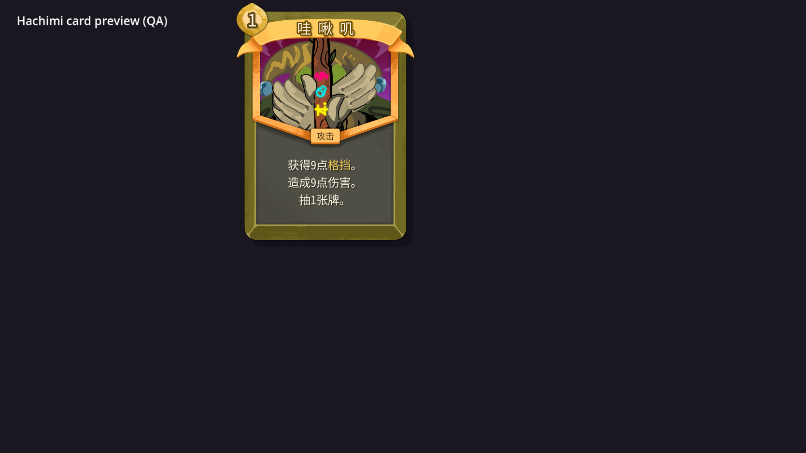
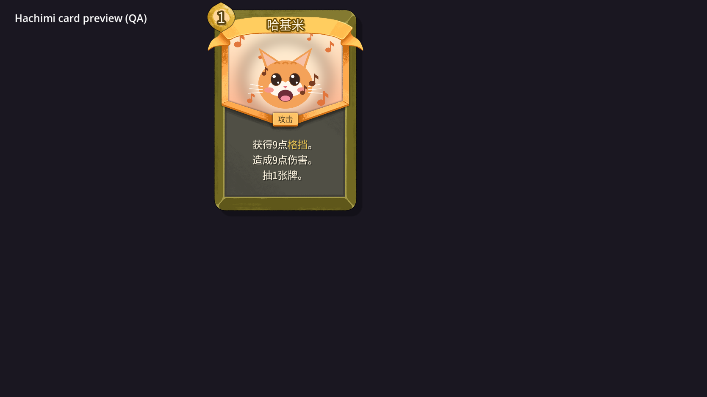

# 哈基米 Hachimi · 杀戮尖塔 2 Mod

把愚者（The Fool）的「**哇 啾 叽**」（内部 ID `WAH_CHO_KI`）换成「**哈基米**」。

| | 原来的「哇 啾 叽」 | 装上本 Mod 后 |
|---|---|---|
| 卡名 | 哇 啾 叽 | **哈基米** |
| 卡面 | 官方卡图 | 原创哈基米猫卡图（唱歌） |
| 出牌音效 | 哇 / 啾 / 叽 三段旋律语音 | **哈基米**语音；该次出牌的 2.5 秒内静音上面三段语音 |
| 费用 / 数值 / 稀有度 / 卡牌 ID | 1 费 · 9 格挡 · 9 伤害 · 抽 1 · 稀有 · `WAH_CHO_KI` | 完全不变 |

数值和卡牌 ID 都没有改动，所以存档、卡牌标签（`Wah/Cho/Ki` 的联动）和联机判定都保持原样，只是「看和听」变了。

## 对比截图

均为游戏内真实画面（同一个 NCard 控件、同一个窗口尺寸与 UI 状态），基线为未安装本 Mod 的游戏 v0.113.0。

| 之前（原版） | 之后（本 Mod） |
|---|---|
|  |  |

## 目录

```
src/                 Mod 源码（C# / Godot.NET.Sdk 4.5.1 / net9.0）
  ModEntry.cs        入口 + 日志
  CardPatches.cs     Harmony 补丁：卡名、卡面路径、出牌音效
  HachimiPortraitLoader.cs  无 .pck 时用 ResourceFormatLoader 提供卡图
  HachimiSound.cs    内嵌 WAV -> AudioStreamWav -> SFX 总线播放
  Hachimi.json       Mod 清单
assets/              内嵌素材（卡图 PNG、语音 WAV）
tools/make_card_art.py     卡图生成脚本（可复现）
tools/PreviewMod/          QA 工具：游戏内渲染卡牌并截图，不随 Mod 安装
build.sh             构建 + 安装到本机 Steam 游戏目录
```

## 构建与安装

```bash
./build.sh          # 需要 .NET 9 SDK；默认装到 Apple Silicon 的 Steam 目录
```

脚本会把 `Hachimi.dll` 和 `Hachimi.json` 复制到
`…/Slay the Spire 2/SlayTheSpire2.app/Contents/MacOS/mods/Hachimi/`。
换机器/换分支时用 `-p:Sts2DataDir=…` 或 `STS2_GAME_DIR=…` 覆盖路径。

## 实现要点

- **卡名**：Harmony 前缀打在 `CardModel.get_Title`，只对 `WahChoKi` 生效。
- **卡面**：改写 `PortraitPath` / `BetaPortraitPath` / `PortraitPngPath` / `AllPortraitPaths`
  指向 `res://Hachimi/images/hachimi_card.png`，并注册一个 `ResourceFormatLoader`
  从 DLL 内嵌资源里解出 `ImageTexture`（没有 `.pck`，所以不能靠资源包覆盖）。
- **音效**：`WahChoKi.OnPlay` 前缀里播放内嵌的哈基米语音（挂在 `SFX` 总线），
  同时打开 2.5 秒窗口，让 `SfxCmd.Play` 跳过该次出牌的
  `event:/sfx/characters/fugitive/fugitive_{wa,cho,ki}` 三段人声。
- 只改这一个卡牌；其它「哇 / 啾 / 叽」卡不受影响。

## 验证记录

- `dotnet build`：0 warning / 0 error。
- 启动日志（`~/Library/Application Support/SlayTheSpire2/logs/godot.log`）：
  ```
  [INFO] Found mod manifest file .../mods/Hachimi/Hachimi.json
  [INFO] Calling initializer method of type Hachimi.ModEntry ...
  [INFO] [Hachimi] portrait loader registered
  [INFO] [Hachimi] voice loaded (63946 PCM bytes, 22050 Hz, stereo=False)
  [INFO] [Hachimi] loaded: Wah Cho Ki is now 哈基米
  [INFO] Finished mod initialization for '哈基米 Hachimi' (Hachimi).
  ```
- 游戏内截图：`docs/evidence/before.png`（原版 `哇 啾 叽`）与 `docs/evidence/after.png`
  （`哈基米` + 新卡图），由 `tools/PreviewMod` 在同一个 `NCard` 控件上抓帧。
- 语音播放路径：`tools/PreviewMod` 调用 `HachimiSound.Play()`，日志出现
  `[Hachimi] voice clip playing`，无资源/音频错误。

## 素材来源与说明

- **语音**：B 站《哈基米常用音效》（[BV1JyYPzyE8w](https://www.bilibili.com/video/BV1JyYPzyE8w)），
  截取 1.00–2.45 秒，转 22050 Hz 单声道 16-bit WAV，响度归一化到 -16 LUFS。
  仅用于个人本地 Mod，未再分发到公开渠道。
- **卡图**：`tools/make_card_art.py` 程序化绘制的原创「唱歌的哈基米猫」，不是官方素材。
- **参考图片缺失**：原始飞书消息里写了「仿照这张图片」，但该消息实际只有文字、没有图片附件，
  所以卡图按「哈基米 + 唱歌（对应原卡的旋律机制）」的方向原创绘制。
  如果参考图有特定构图/画风需求，补图后可以按图重画。

## 兼容性

- 测试环境：macOS arm64，Steam 版 *Slay the Spire 2* **v0.113.0 (public-beta)**。
  「哇 啾 叽」是 v0.113 新增的愚者卡；更老的版本没有这张卡，请不要安装。
- 依赖：无（不依赖 BaseLib / RitsuLib）。
- 与其它改卡面的 Mod 共存时，卡图以最后生效的补丁为准。
